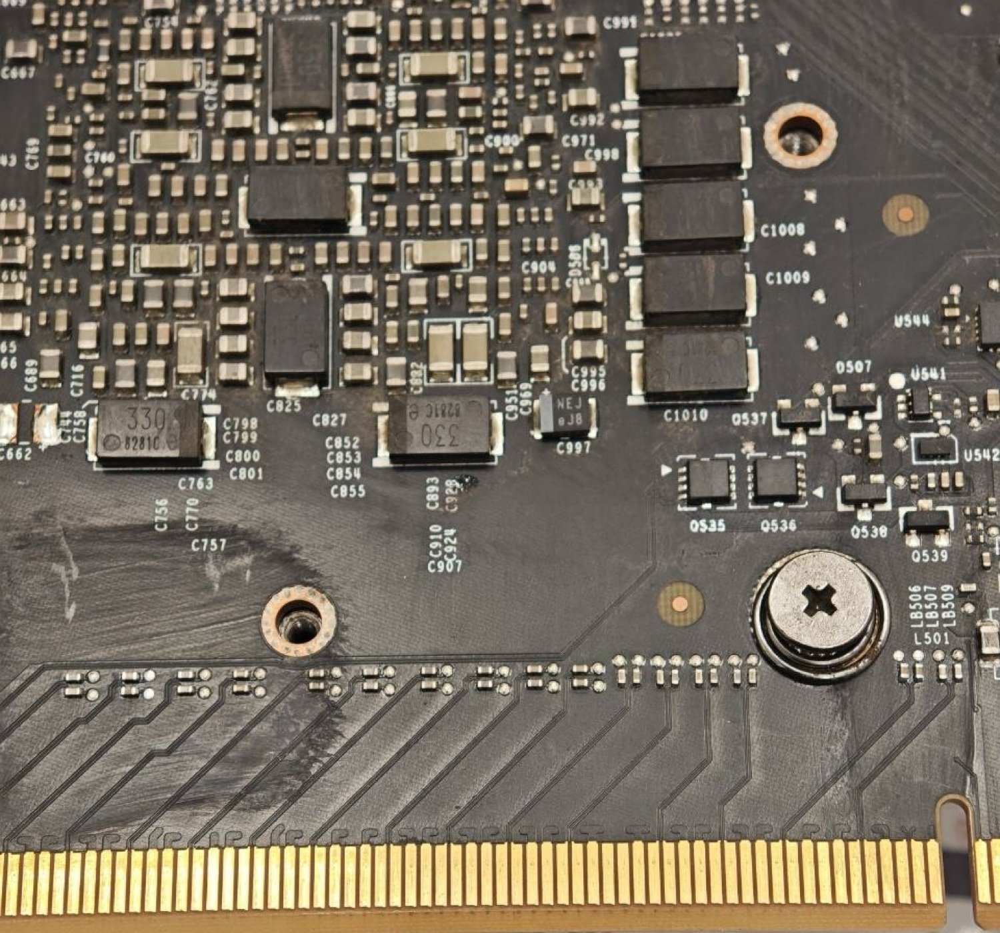
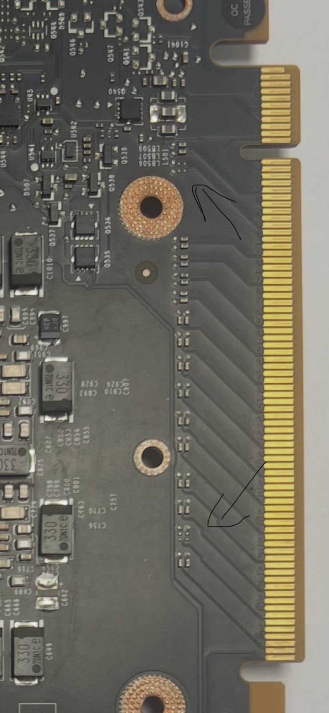
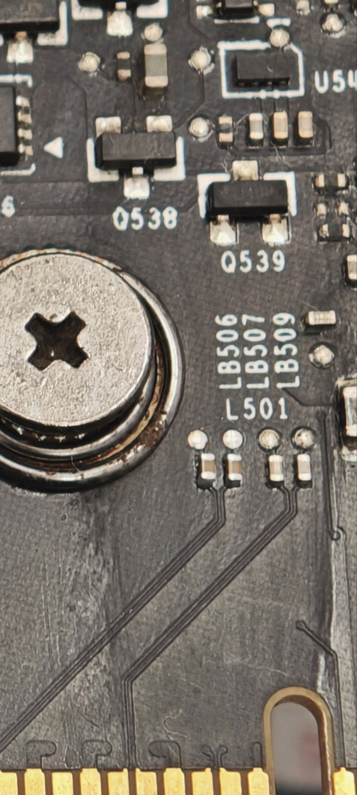
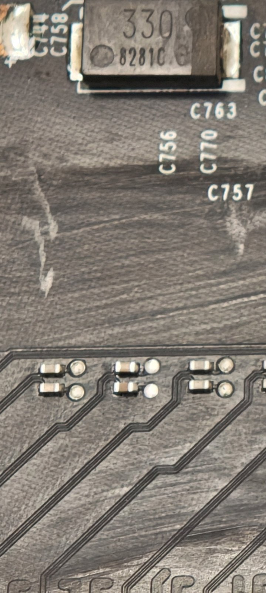

# Gen2 and x16: handoff to contributors

Author: 6Robert123. Scope is GP100/Pascal CMP 100-100. GV100/Volta CMP100-210 and other CMP architectures are controls or hypotheses, not validated interchangeable methods.

## Experimental anchor

The [separated MAX16 experiment](../research/archive/evidence_20261031_cmp02_x16/separated_max_native_width_01/execution_01/RESULT_RU.md) changed advertised `LnkCap` from `00453c11` to `00453d01`. Three separated read pairs confirmed cap16 before a single native command2. The command read `80089010` over 40 bounded polls and timed out. A 90-second paired endpoint/root observer retained 450 rows, all Gen1 x1. [Raw stdout](../research/archive/evidence_20261031_cmp02_x16/separated_max_native_width_01/execution_01/raw_capture/run_01/stdout.txt) and [paired samples](../research/archive/evidence_20261031_cmp02_x16/separated_max_native_width_01/execution_01/raw_capture/run_01/endpoint_root_linksta.jsonl) are included as redacted copies. See the [recovery record](../research/archive/evidence_20261031_cmp02_x16/separated_max_native_width_01/execution_01/RECOVERY_RESULT_RU.md) and [PMU-label correction](../research/archive/evidence_20261031_cmp02_x16/separated_max_native_width_01/confound_audit_01/RESULT_RU.md).

This is a post-initialization experiment. A changed maximum capability is not a negotiated physical link. It does not establish preboot policy equivalence, an absolute fuse barrier, or a physical-only root cause.

## Hardware photos: the modded card used for the width experiment

These photos show the CMP 100-100 board on which the x16 width experiment was run. They document the hardware state only. With this board the link still trained at **Gen1 x1**, so the photos are not evidence that Gen2 or x16 works. Metadata was stripped, the images were resized, and the full-edge photo was cropped.

*Full PCIe edge. Small two-pad footprints in a row above the x16 contact fingers are populated along the edge. These are presumably the lane coupling capacitor pads.*

*Overview of the PCIe edge. The hand-drawn arrows mark the lane area: the upper one near L501/Q538–Q539, the lower one at the lower row of (presumed) lane coupling capacitors.*

*Close-up near L501/LB506/LB507/LB509, with populated pads above the edge traces.*

*Close-up of populated pads (presumed lane coupling capacitors) below the C756/C757/C770 silkscreen.*

## Gen2 evidence

The [Gen2 reports](../research/archive/evidence_20261026_gen2x1/START_HERE_RU.md) record unsuccessful runtime paths and controls. The [global5 trial](../research/archive/evidence_20261026_gen2x1/current_bif_preflight/RESULT_GLOBAL5_RU.md) observed the requested policy but did not enable the expected internal Gen2 flag. Saved register values, receiver identities and phases must be kept separate; historical pointers from earlier boots cannot be reused.

## Highest-value questions

1. **Training/command completion:** identify the GP100 consumer and meanings of LINK_CONFIG_0 low five bits, including `0x10` and exceptional word `0x65`. A polling loop is not enough to assign hardware semantics to bit4. Separate request, timeout, reset, and actual LTSSM/PHY state.
2. **Early versus live policy:** trace the IFR record executor and its ordering relative to latch/training; determine reapplication. Runtime cap16 does not rule out a materially different preboot path.
3. **IFR integrity:** find the actual checker/coverage. Original byte sums are observations; two identical CMP IFRs are not independent evidence. No guessed compensation byte should be treated as valid formatting.
4. **Physical lanes:** inspect/compare wiring and components or obtain validated per-lane status. Clean AER at x1 does not demonstrate whether extra lanes are missing, disabled, or unrequested.
5. **MODS reset membership:** reset-list global `0xf7a7fb8` differs from `GpuDevMgr` `0xf7a7fd0` in the pinned 520.112 ELF. A static producer belongs to `NvLinkDevIf::TopologyManagerProtobuf` and creates SimGpuDev objects. Physical GP100 membership and filtering remain unresolved. [Trace](../research/archive/evidence_20261031_archive_reassessment/pcie_trace/RESET_PRODUCER_TRACE_RU.md).
6. **Memory:** find actual fitted-package identity or a validated physical ID path; masks and geometry arithmetic cannot prove stack height or 8 GiB/package. The studied JTAG error path can leave state uncleared; it is not a ready diagnostic recipe.

## Offline SPI candidates

[Input/candidate pins](../research/SPI_INPUTS.json), [width builder](../tools/spi/build_width_candidate.py), and [operand patcher](../tools/spi/patch_ifr_records.py) are retained. These scripts write only local candidate files; they do not flash. They require the matching original hash, owned separately by the contributor. `w16a` changes two bytes in one operand word. Other names do not certify speed-only semantics. Full dumps/candidates with board metadata are deliberately omitted.

All tools and reports are evidence, not authorization to reproduce destructive or stateful experiments. A useful new run must capture endpoint AND upstream negotiated speed/width, baseline and final health, operation return codes, restoration status, and workload/readback. Include negative outcomes. Avoid another old write/retrain trial without a new discriminating premise.
